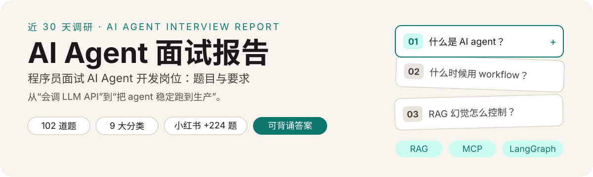
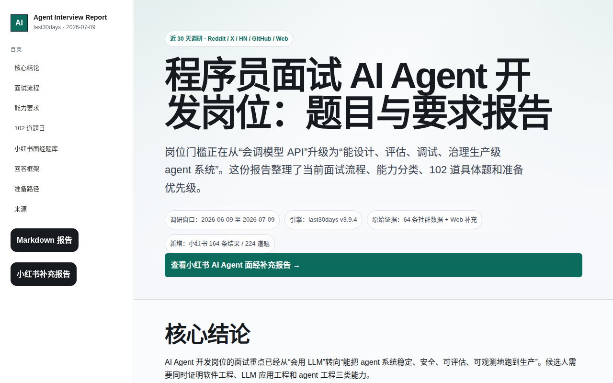
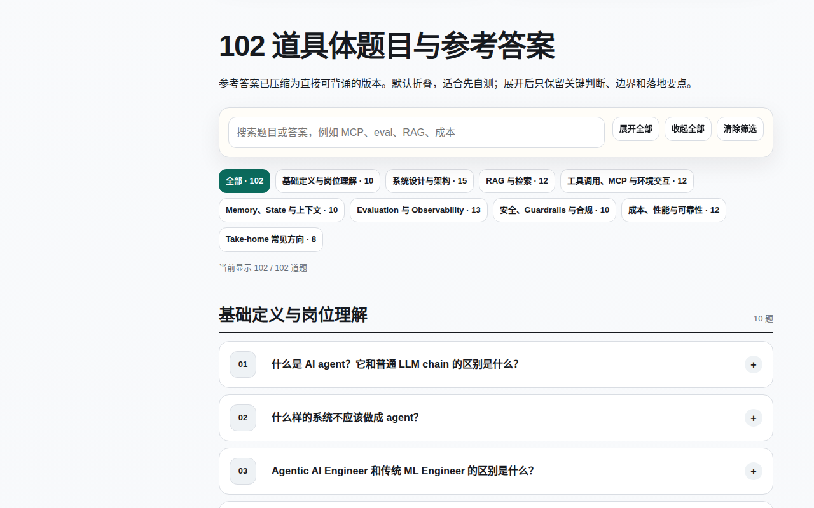

<p align="right"><a href="README.md">中文</a></p>

<p align="center">
  
</p>

<p align="center">
  <a href="https://holynova.github.io/ai-agent-interview-report/">▶ Read Online</a>
  ·
  <a href="https://github.com/holynova/ai-agent-interview-report">GitHub Repository</a>
</p>

This is an interview report for programmers applying to AI Agent developer roles: based on 30 days of research (2026-06-09 to 2026-07-09) across Reddit, X, Hacker News, GitHub and web search, it covers the interview process, skill requirements, and 102 interview questions with concise, memorizable reference answers. A Xiaohongshu supplement adds 224 more questions (from 164 deduplicated search results). The interactive version supports search, category filters, and foldable self-testing.

## Screenshots

<p align="center">
  
</p>
<p align="center">
  
</p>

## Key Findings

The interview focus for AI Agent developer roles has shifted from "can you call an LLM API" to "can you run an agent system in production — stably, safely, evaluably, observably". Candidates must prove three skill sets at once:

1. **Software engineering**: Python, backend APIs, async, databases, Docker, CI/CD, testing, cloud deployment, observability.
2. **LLM application engineering**: prompting, structured output, function calling, RAG, reranking, context management, model selection.
3. **Agent engineering**: LangGraph / CrewAI / AutoGen / OpenAI Agents SDK / MCP, tool calling, state, memory, multi-agent orchestration, evals, guardrails, cost control, human-in-the-loop.

Traditional algorithm questions haven't disappeared, but they're no longer the main event; the real differentiators are system design, agentic system design, production postmortems, evals, and debugging ability.

## 102 Questions · 9 Categories

| Category | Count | Category | Count |
|---|---|---|---|
| 基础定义与岗位理解 (Fundamentals & Role Understanding) | 10 | Evaluation 与 Observability | 13 |
| 系统设计与架构 (System Design & Architecture) | 15 | 安全、Guardrails 与合规 (Safety, Guardrails & Compliance) | 10 |
| RAG 与检索 (RAG & Retrieval) | 12 | 成本、性能与可靠性 (Cost, Performance & Reliability) | 12 |
| 工具调用、MCP 与环境交互 (Tool Calling, MCP & Environment Interaction) | 12 | Take-home 常见方向 (Common Take-Home Directions) | 8 |
| Memory、State 与上下文 (Memory, State & Context) | 10 | | |

Reference answers are trimmed to a directly memorizable form, collapsed by default for self-testing first; expanding keeps the key judgments, boundaries, and practical points, and key technical terms are clickable for explanations.

## Interview Process

1. **Recruiter / Hiring Manager screen**: confirms whether you've actually built LLM or agent projects and shipped them to real users.
2. **Technical screen**: usually 45–60 minutes, reasoning-heavy, not necessarily live-coding hard algorithms.
3. **AI assessment / take-home**: typically 2–4 hours — build a RAG-plus-agent, a small tool-calling agent, or an agentic QA service, and it must include evals.
4. **System design**: customer-service agent, SOC agent, multi-tenant external-data QA, multi-agent workflow, agent observability.
5. **Take-home walkthrough**: explain the architecture, tradeoffs, failure modes, testing, cost, and next improvements.
6. **Bar raiser / CTO / senior loop**: production experience, business constraints, safety boundaries, cost control, teamwork.

## Files

```
index.html                              Interactive report (search / filters / foldable self-test)
report.md                               Full report in Markdown
xiaohongshu-ai-agent-interview-report.html   Xiaohongshu supplement: 164 results / 224 questions
```

## Read Locally

Pure static pages — just open `index.html`, or serve them statically:

```bash
python3 -m http.server 8000
# Open http://localhost:8000
```

## Sources & Method

- Research window: 2026-06-09 to 2026-07-09; generated 2026-07-09.
- Engine: last30days v3.9.4; sources: Reddit, X, Hacker News, GitHub, plus web search.
- Xiaohongshu supplement: 164 deduplicated search results, 48 notes fetched in full, 224 deduplicated questions with reference answers.
