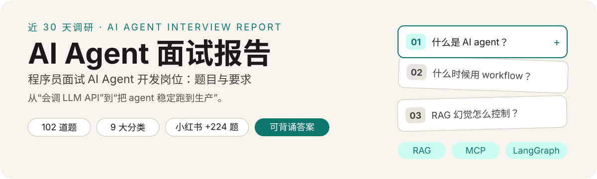
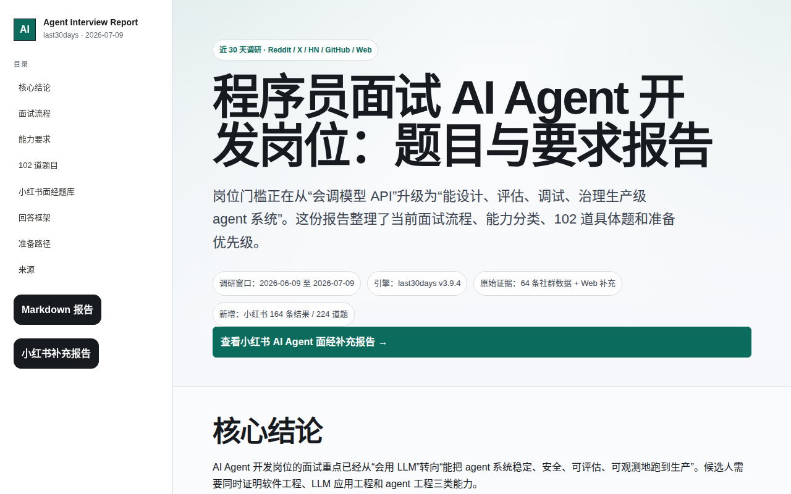
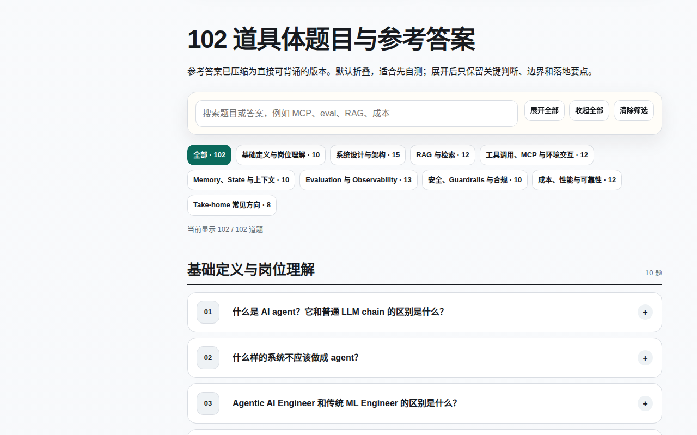

<p align="right"><a href="README.en.md">English</a></p>

<p align="center">
  
</p>

<p align="center">
  <a href="https://holynova.github.io/ai-agent-interview-report/">▶ 在线阅读</a>
  ·
  <a href="https://github.com/holynova/ai-agent-interview-report">GitHub 仓库</a>
</p>

这是一份程序员面试 AI Agent 开发岗位的调研报告：近 30 天（2026-06-09 至 2026-07-09）覆盖 Reddit、X、Hacker News、GitHub 与 Web 搜索，整理出面试流程、能力要求分类与 102 道具体题目及可直接背诵的参考答案。另有小红书补充版（164 条去重搜索结果、224 道题）。交互版支持搜索、分类筛选与折叠自测。

## 截图

<p align="center">
  
</p>
<p align="center">
  
</p>

## 核心结论

AI Agent 开发岗位的面试重点已经从"会调 LLM API"转向"能把 agent 系统稳定、安全、可评估、可观测地跑到生产"。候选人需要同时证明三类能力：

1. **软件工程能力**：Python、后端 API、异步、数据库、Docker、CI/CD、测试、云部署、可观测性。
2. **LLM 应用工程能力**：prompt、structured output、function calling、RAG、reranking、上下文管理、模型选择。
3. **Agent 工程能力**：LangGraph / CrewAI / AutoGen / OpenAI Agents SDK / MCP、工具调用、状态、记忆、多 agent 编排、evals、guardrails、成本控制、human-in-the-loop。

传统算法题没有完全消失，但不再是主战场；核心区分度来自系统设计、agentic system design、生产复盘、eval 和调试能力。

## 102 道题目 · 9 大分类

| 分类 | 题数 | 分类 | 题数 |
|---|---|---|---|
| 基础定义与岗位理解 | 10 | Evaluation 与 Observability | 13 |
| 系统设计与架构 | 15 | 安全、Guardrails 与合规 | 10 |
| RAG 与检索 | 12 | 成本、性能与可靠性 | 12 |
| 工具调用、MCP 与环境交互 | 12 | Take-home 常见方向 | 8 |
| Memory、State 与上下文 | 10 | | |

参考答案已精简为直接可背诵的版本，默认折叠、适合先自测；展开后保留关键判断、边界与落地要点，关键技术术语可点击查看解释。

## 面试流程画像

1. **Recruiter / Hiring Manager screen**：确认是否真正做过 LLM 或 agent 项目，是否上线到真实用户。
2. **技术 screen**：通常 45–60 分钟，偏 reasoning，不一定现场写复杂算法。
3. **AI assessment / take-home**：常见 2–4 小时，构建 RAG-plus-agent、小型工具调用 agent 或 agentic QA service，且必须带 eval。
4. **系统设计**：客服 agent、SOC agent、多租户 external data QA、multi-agent workflow、agent observability。
5. **Take-home walkthrough**：解释架构、tradeoffs、失败模式、测试、成本、下一步改进。
6. **Bar raiser / CTO / senior loop**：生产经验、业务约束、安全边界、成本控制、团队协作。

## 文件

```
index.html                              交互版报告（搜索 / 筛选 / 折叠自测）
report.md                               Markdown 版报告全文
xiaohongshu-ai-agent-interview-report.html   小红书补充版：164 条结果 / 224 道题
```

## 本地阅读

纯静态页面，直接打开 `index.html` 即可；或起一个静态服务器：

```bash
python3 -m http.server 8000
# 打开 http://localhost:8000
```

## 来源与方法

- 调研窗口：2026-06-09 至 2026-07-09；生成日期：2026-07-09。
- 引擎：last30days v3.9.4；来源：Reddit、X、Hacker News、GitHub，补充 Web 搜索。
- 小红书补充版：164 条去重搜索结果、48 篇已抓取详情笔记、224 道去重题目与参考答案。
